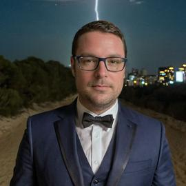

## About

Dr. Christian Sandor is a Professor at Université Paris-Saclay and the leader of the ARAI team at CNRS. Since the year 2000, his foremost research interest is Augmented Reality (AR), as he believes that it will have a profound impact on the future of mankind. Together with his students, he won multiple awards at the premier AR conference, IEEE International Symposium on Mixed and Augmented Reality (IEEE ISMAR), best paper at ACM Symposium on Spatial User Interaction (2018), and best demo (audience vote) at ACM SIGGRAPH Asia XR (2023). He currently serves as an editorial board member for Virtual Reality & Intelligent Hardware and as a steering committee member for ACM Symposium on Spatial User Interaction. He has been program chair for numerous conferences, including IEEE ISMAR and ACM SIGGRAPH Asia XR.

## Website

[https://drsandor.net/](https://drsandor.net/)